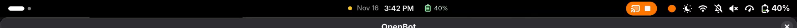
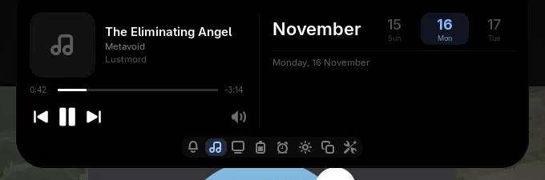
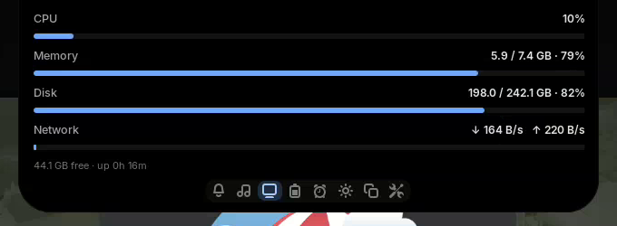
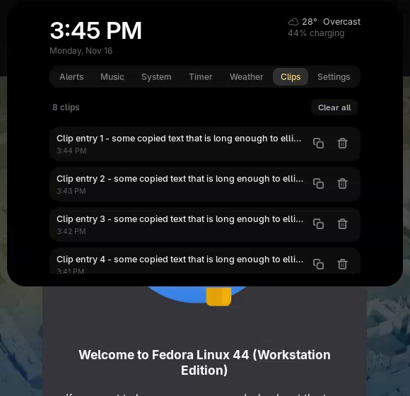
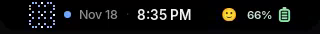
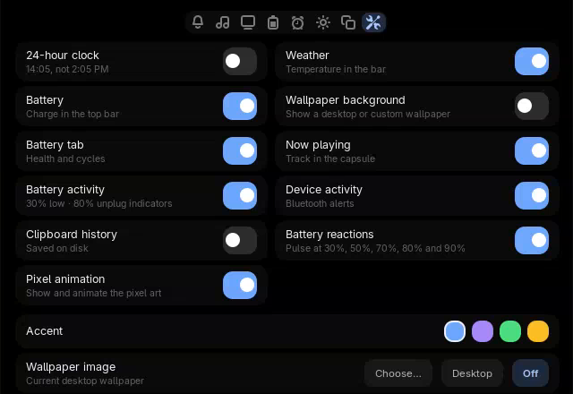

# Island — a Dynamic Island for GNOME Shell

<a href="https://extensions.gnome.org/extension/11796/island/"></a>
<a href="https://extensions.gnome.org/extension/11796/island/"></a>


One black notch at the top centre of your screen. Hover it and it opens into
a wide, short card — media on the left, calendar on the right — with a slim
icon dock for alerts, system meters, battery health, a timer, weather,
clipboard history and settings. Battery cues stay inline in the compact island;
Bluetooth devices, notifications and finished timers appear as live activities.

No bundler, no daemon, no Electron. It is a single GNOME Shell extension.





## Features

| Area | What you get |
|---|---|
| **Clock** | Time (12/24 h) and full date, replacing GNOME's clock button |
| **Weather** | Current conditions, temperature / precipitation / wind charts, °C / °F switch and 8-day forecast (Open-Meteo) |
| **Alerts** | Mirrors system notifications, unread badge, click a row to run the notification's own action / raise its app, clear all |
| **Music** | MPRIS now playing with album art, title/album/artist, elapsed and remaining time, clickable + draggable seek bar, prev/play-pause/next |
| **System** | Live CPU, memory, disk and network meters with a one-second sampler |
| **Battery** | Inline 30% low-charge and 80% unplug reminders, mood indicator, health %, cycle count, power draw and capacity details |
| **Timer** | 1 / 5 / 10 / 25 minute presets, start-pause-reset, finish alert |
| **Clips** | Clipboard history (30 entries, persisted to disk), copy back, delete, clear all |
| **Settings** | Module toggles, accent colour, animation speed, pixel-art styles, wallpaper image and blur, auto-close delay |

### Live activities

iPhone-style transient capsules, queued so a new event never overwrites the
one on screen. Battery changes use the inline indicator above.

- Bluetooth device connected, with battery percentage when reported
- incoming notification
- timer finished

Clicking an activity opens the tab it belongs to, or the app that sent it.

## Screenshots

| System | Battery | Clipboard |
|---|---|---|
|  |  |  |

## Battery indicators

The compact island keeps a small mood emoji beside the charging percentage.
It changes with the battery level and pulses at 30%, 50%, 70%, 80% and 90%.
At 30% while discharging it signals low charge; at 80% while charging it
reminds you to unplug. The 80% cue is a reminder only and does not stop
charging automatically.





## Requirements

- GNOME Shell **49 or 50** (developed and tested on 50.6, Wayland)
- Fedora, Ubuntu, Arch — anything with GNOME Shell and UPower
- Optional: an MPRIS-compatible player for the Music tab (Firefox, Spotify,
  Rhythmbox, Celluloid…)

## Install

### From the zip

```sh
unzip island@nexa.local.zip -d ~/.local/share/gnome-shell/extensions/island@nexa.local
gnome-extensions enable island@nexa.local
```

Log out and back in once. On Wayland the shell only scans new extension folders
at login; after that, edits to `impl.js` reload the island live.

### From source

```sh
git clone https://github.com/yash5800/linux-island.git
./install.sh
```

`install.sh` copies the four runtime files (plus the licence) into
`~/.local/share/gnome-shell/extensions/island@nexa.local` and enables the
extension.

### Uninstall

```sh
gnome-extensions disable island@nexa.local
rm -rf ~/.local/share/gnome-shell/extensions/island@nexa.local
```

GNOME's clock button reappears on disable; nothing else is modified.

## Usage

- **Hover** the notch → opens the wide card: player left, calendar right.
- **Click** a dock icon → switch to alerts, system, battery, timer, weather, clips or settings.
- **Escape** or a click outside → close the card.
- Leave the pointer → collapses after the auto-close delay (Settings).
- Click the album art or seek bar while music plays to scrub.

## Tabs

| Tab | Contents |
|---|---|
| Alerts | Notification mirror, unread badge |
| Music | Now playing, cover art, transport, seek |
| System | CPU / memory / disk / network |
| Battery | Charge, health, cycles, capacity, power |
| Timer | Presets and running countdown |
| Weather | Current conditions, three hourly charts, 8-day forecast |
| Clips | Clipboard history |
| Settings | Toggles, accent, speed, auto-close |

## Settings

Stored at `$XDG_CONFIG_HOME/island-gnome/settings.json` (usually
`~/.config/island-gnome/settings.json`).

| Setting | Effect |
|---|---|
| 24-hour clock | `14:05` instead of `2:05 PM` |
| Weather | Temperature in the bar and the Weather tab |
| Battery | Battery line in the panel header |
| Battery tab | Show/hide the Battery tab |
| Now playing | Track line in the expanded bar and Music tab |
| Battery activity | Inline charging, 30% low-charge and 80% unplug indicators |
| Battery reactions | Pulse the indicator at 30%, 50%, 70%, 80% and 90% |
| Device activity | Bluetooth connect activities |
| Clipboard history | Keep copied text on disk (off until you turn it on) |
| Wallpaper background | Optional custom or desktop wallpaper inside the island (off by default) |
| Wallpaper image | Choose a local image or use the desktop wallpaper |
| Wallpaper blur | Off, low, medium or strong |
| Accent | Blue, violet, green, amber |
| Animation | Slow, normal, fast (scales every duration) |
| Pixel art | Spark, anime, car or cyberpunk sprites |
| Pixel animation | Show or hide the animated pixel art |
| Auto-close | 0.8 s, 0.4 s or off |

## Where the data comes from

| Data | Source |
|---|---|
| Battery percentage / state | UPower `DisplayDevice` on the system bus, sysfs fallback |
| Battery health / cycles | UPower battery device (`/org/freedesktop/UPower/devices/battery_*`) |
| CPU, memory, network | `/proc/stat`, `/proc/meminfo`, `/proc/net/dev` |
| Disk | `Gio.File.query_filesystem_info('/')` |
| Weather | [Open-Meteo](https://open-meteo.com/), coordinates from `~/.config/dynamic-island/config.json` |
| Music | MPRIS over the session bus |
| Notifications | GNOME `MessageTray` (the stock banner is suppressed) |
| Clipboard | `St.Clipboard`, polled every 2 s **only while history is on** |

## Privacy

- Clipboard history is **off by default**. Nothing is read from the selection
  until you turn it on — the Clips tab shows an opt-in button, and the switch
  is also in Settings. Once on, copied text is stored in plain text at
  `$XDG_DATA_HOME/island-gnome/clipboard.json` (30 entries, 2000 chars each).
  Turning it off stops polling immediately; delete the file to erase what is
  already stored.
- Weather sends only your configured latitude/longitude to Open-Meteo. No
  account, no key, no other telemetry.
- Nothing leaves the machine otherwise; the extension has no analytics and no
  remote logging.

## How it works

```
extension.js   entry point. In the working folder it is a loader — the only
               file GNOME caches — that watches impl.js and stylesheet.css and
               re-imports them with a cache-busting query, so saving a file
               reloads the island without logout. The release build replaces
               it with a plain `import Island from './impl.js'`.
impl.js        the island: Clutter/St UI, timers, DBus clients, live activities,
               notification takeover.
stylesheet.css St theme: black surface, 12px type ramp, radii 8/12/18/26.
metadata.json  extension manifest.
```

Two shell hooks are used: the clock button is hidden while the extension runs,
and `MessageTray.Source.prototype.addNotification` is wrapped so notifications
can be mirrored while the stock banner is suppressed. Both are undone in
`disable()`.

## Development

Editing `impl.js` or `stylesheet.css` in the installed folder reloads the
island within ~350 ms:

```sh
journalctl --user -b -o cat _COMM=gnome-shell | grep island
```

A headless test shell is included for interaction that cannot be driven on
Wayland:

```sh
tools/run-headless.sh 6 panel battery   # mode: panel | compact | alert | notify
```

Set `FAKE_PLAYER=1` to register a test MPRIS player, and
`ISLAND_CLIPS` / `ISLAND_SETTINGS` to point at JSON fixtures.

`AGENTS.md` and `SKILL.md` describe the file map, data sources and the safe
recipes for adding a tab, a setting, a metric or a live activity. Read them
before changing structure.

## Releasing to extensions.gnome.org

The folder in `~/.local/share/gnome-shell/extensions` is the development build.
Ship a release build instead:

```sh
tools/build-release.sh        # writes dist/island@nexa.local.zip
```

That zip has the five files EGO expects at the root and a plain `extension.js`
with no hot-reload loader and no file monitors. Before every upload:

1. Bump `version` in `metadata.json` (an upload must be a new integer).
2. Keep `shell-version` to the releases actually tested.
3. Check the zip: `unzip -l dist/island@nexa.local.zip`.

Then sign in at <https://extensions.gnome.org/accounts/login/> with an email
link and upload at <https://extensions.gnome.org/upload/>. Review is
volunteer-run and takes weeks; approved versions are the only ones anyone can
install from the site. Users who do not want to wait can install from the zip
in this repo.

## Known limitations

- Uses a few private shell APIs (`Main.panel.statusArea.dateMenu`,
  `MessageTray` banner internals) that can change between GNOME releases.
- Wayland does not let a script inject pointer events, so hover/click are
  verified in the headless shell, not on a live session.
- Weather coordinates are fixed in the Electron-era config file; there is no
  geolocation and no °F toggle yet.
- The hourly forecast strip can start at a past hour late in the day.
- No mic/camera indicators, AirDrop, calls or screen-recording state — GNOME's
  own indicators still cover privacy.

## License

MIT — see [LICENSE](LICENSE). Use it, change it, ship it, just keep the
copyright notice.

## Contributing

Issues and PRs are welcome. Keep the extension dependency-free, run
`node --check impl.js` before committing, and note which GNOME version you
tested on.
