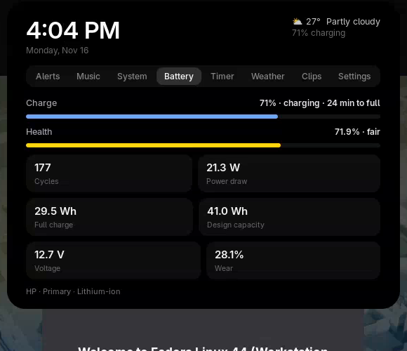

# Island — a Dynamic Island for GNOME Shell

One black capsule at the top centre of your screen, where the clock used to
be. Hover it and it peeks; click it and it becomes a small dashboard: alerts,
now playing, system meters, battery health, a timer, weather, clipboard
history and settings. Transient events — charging, low battery, a Bluetooth
device, a notification, a finished timer — slide in as live activities and go
away on their own.

No bundler, no daemon, no Electron. It is a single GNOME Shell extension.


## Features

| Area | What you get |
|---|---|
| **Clock** | Time (12/24 h) and full date, replacing GNOME's clock button |
| **Weather** | Current conditions, feels-like, humidity, wind, next 6 hours, 2-day forecast (Open-Meteo) |
| **Alerts** | Mirrors system notifications, unread badge, click a row to run the notification's own action / raise its app, clear all |
| **Music** | MPRIS now playing with album art, title/artist, elapsed and remaining time, clickable + draggable seek bar, prev/play-pause/next |
| **System** | Live CPU, memory, disk and network meters with a one-second sampler |
| **Battery** | Charge and time to full/empty, health %, cycle count, power draw, full and design capacity, voltage, wear, vendor/model/chemistry |
| **Timer** | 1 / 5 / 10 / 25 minute presets, start-pause-reset, finish alert |
| **Clips** | Clipboard history (30 entries, persisted to disk), copy back, delete, clear all |
| **Settings** | Module toggles, accent colour, animation speed, auto-close delay |

### Live activities

iPhone-style transient capsules, queued so a new event never overwrites the
one on screen:

- charging, on battery, fully charged
- low battery (20%) and critical (10%)
- Bluetooth device connected, with battery percentage when reported
- incoming notification
- timer finished

Clicking an activity opens the tab it belongs to, or the app that sent it.

## Screenshots

| System | Battery | Clipboard |
|---|---|---|
|  |  |  |

## Requirements

- GNOME Shell **49 or 50** (developed and tested on 50.6, Wayland)
- Fedora, Ubuntu, Arch — anything with GNOME Shell and UPower
- Optional: an MPRIS-compatible player for the Music tab (Firefox, Spotify,
  Rhythmbox, Celluloid…)

## Install

### From the zip

```sh
unzip island@nexa.local.zip -d ~/.local/share/gnome-shell/extensions/island@nexa.local
gnome-extensions enable island@nexa.local
```

Log out and back in once. On Wayland the shell only scans new extension folders
at login; after that, edits to `impl.js` reload the island live.

### From source

```sh
git clone https://github.com/yash5800/linux-island.git
./install.sh
```

`install.sh` copies the four runtime files (plus the licence) into
`~/.local/share/gnome-shell/extensions/island@nexa.local` and enables the
extension.

### Uninstall

```sh
gnome-extensions disable island@nexa.local
rm -rf ~/.local/share/gnome-shell/extensions/island@nexa.local
```

GNOME's clock button reappears on disable; nothing else is modified.

## Usage

- **Hover** the pill → peek (clock, weather, now playing).
- **Click** → open the panel. Click a tab to switch.
- **Escape** or a click outside → close the panel.
- Leave the pointer → collapses after the auto-close delay (Settings).
- Click the album art or seek bar while music plays to scrub.

## Tabs

| Tab | Contents |
|---|---|
| Alerts | Notification mirror, unread badge |
| Music | Now playing, cover art, transport, seek |
| System | CPU / memory / disk / network |
| Battery | Charge, health, cycles, capacity, power |
| Timer | Presets and running countdown |
| Weather | Current + hourly + 2-day |
| Clips | Clipboard history |
| Settings | Toggles, accent, speed, auto-close |

## Settings

Stored at `$XDG_CONFIG_HOME/island-gnome/settings.json` (usually
`~/.config/island-gnome/settings.json`).

| Setting | Effect |
|---|---|
| 24-hour clock | `14:05` instead of `2:05 PM` |
| Weather | Temperature in the bar and the Weather tab |
| Battery | Battery line in the panel header |
| Battery tab | Show/hide the Battery tab |
| Now playing | Track line in the expanded bar and Music tab |
| Battery activity | Charging / low-battery live activities |
| Device activity | Bluetooth connect activities |
| Clipboard history | Keep copied text on disk |
| Accent | Blue, violet, green, amber |
| Animation | Slow, normal, fast (scales every duration) |
| Auto-close | 0.8 s, 0.4 s or off |

## Where the data comes from

| Data | Source |
|---|---|
| Battery percentage / state | UPower `DisplayDevice` on the system bus, sysfs fallback |
| Battery health / cycles | UPower battery device (`/org/freedesktop/UPower/devices/battery_*`) |
| CPU, memory, network | `/proc/stat`, `/proc/meminfo`, `/proc/net/dev` |
| Disk | `Gio.File.query_filesystem_info('/')` |
| Weather | [Open-Meteo](https://open-meteo.com/), coordinates from `~/.config/dynamic-island/config.json` |
| Music | MPRIS over the session bus |
| Notifications | GNOME `MessageTray` (the stock banner is suppressed) |
| Clipboard | `St.Clipboard` polled every 2 s |

## Privacy

- Clipboard history is **on by default** and stores copied text in plain text
  at `$XDG_DATA_HOME/island-gnome/clipboard.json` (30 entries, 2000 chars
  each). Turn it off in Settings, or delete the file to erase it.
- Weather sends only your configured latitude/longitude to Open-Meteo. No
  account, no key, no other telemetry.
- Nothing leaves the machine otherwise; the extension has no analytics and no
  remote logging.

## How it works

```
extension.js   loader — the only file GNOME caches. Watches impl.js and
               stylesheet.css and re-imports them with a cache-busting query,
               so saving a file reloads the island without logout.
impl.js        the island: Clutter/St UI, timers, DBus clients, live activities,
               notification takeover.
stylesheet.css St theme: black surface, 12px type ramp, radii 8/12/18/26.
metadata.json  extension manifest.
```

Two shell hooks are used: the clock button is hidden while the extension runs,
and `MessageTray.Source.prototype.addNotification` is wrapped so notifications
can be mirrored while the stock banner is suppressed. Both are undone in
`disable()`.

## Development

Editing `impl.js` or `stylesheet.css` in the installed folder reloads the
island within ~350 ms:

```sh
journalctl --user -b -o cat _COMM=gnome-shell | grep island
```

A headless test shell is included for interaction that cannot be driven on
Wayland:

```sh
tools/run-headless.sh 6 panel battery   # mode: panel | compact | peek | alert
```

`AGENTS.md` and `SKILL.md` describe the file map, data sources and the safe
recipes for adding a tab, a setting, a metric or a live activity. Read them
before changing structure.

## Known limitations

- Uses a few private shell APIs (`Main.panel.statusArea.dateMenu`,
  `MessageTray` banner internals) that can change between GNOME releases.
- Wayland does not let a script inject pointer events, so hover/click are
  verified in the headless shell, not on a live session.
- Weather coordinates are fixed in the Electron-era config file; there is no
  geolocation and no °F toggle yet.
- The hourly forecast strip can start at a past hour late in the day.
- No mic/camera indicators, AirDrop, calls or screen-recording state — GNOME's
  own indicators still cover privacy.

## License

MIT — see [LICENSE](LICENSE). Use it, change it, ship it, just keep the
copyright notice.

## Contributing

Issues and PRs are welcome. Keep the extension dependency-free, run
`node --check impl.js` before committing, and note which GNOME version you
tested on.
